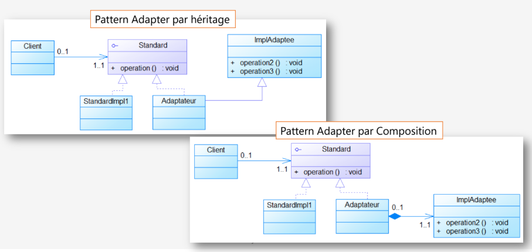
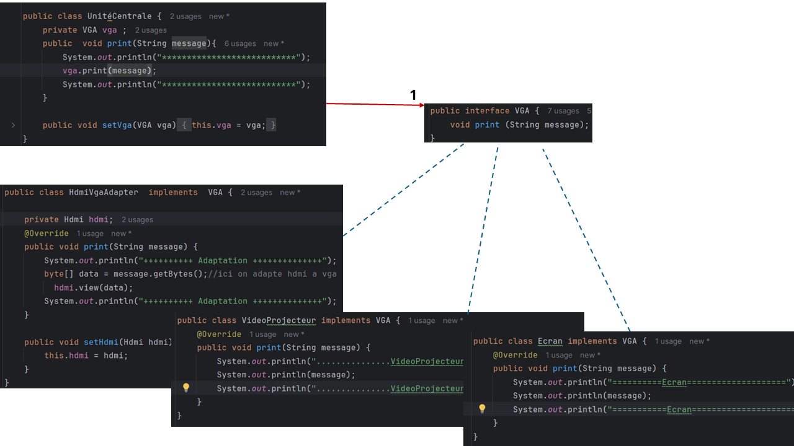
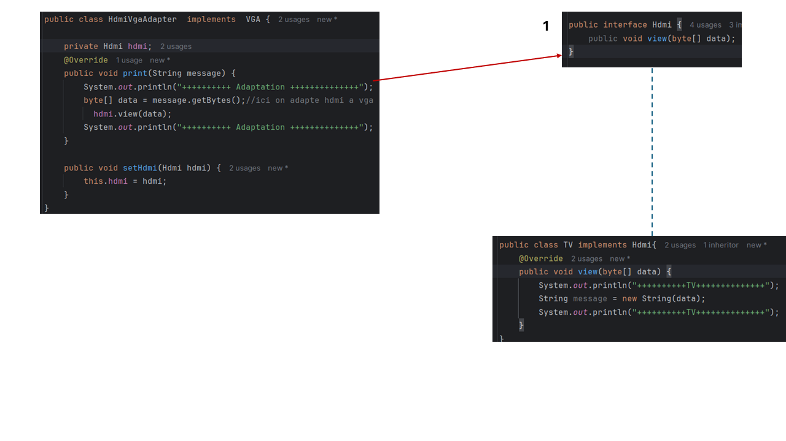
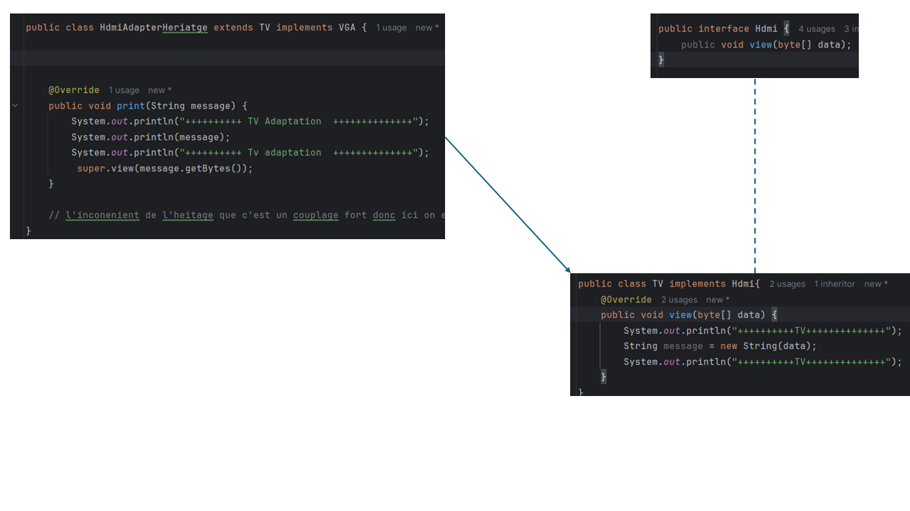
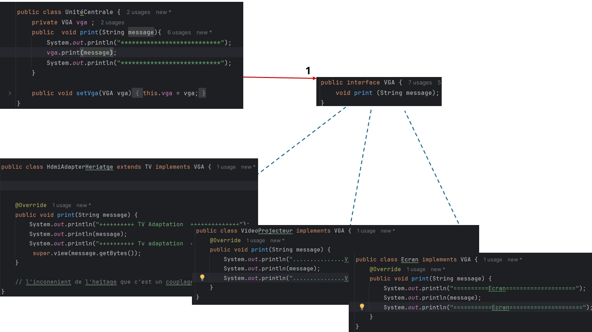
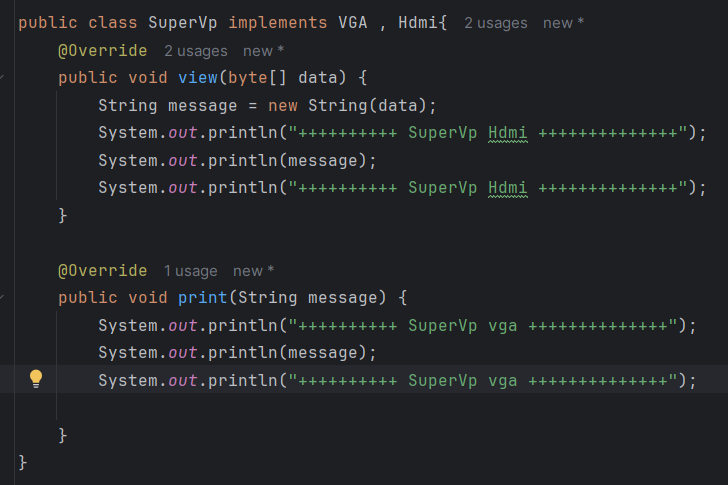

# Design Pattern Adapter

Ce projet met en pratique le **Design Pattern Adapter**, qui permet de faire collaborer des interfaces incompatibles. Il agit comme un pont entre une interface attendue par le client (la cible) et une interface existante qui ne correspond pas à ses besoins (l'adapté).

*Image 1 : Contexte général avec UniteCentrale, VGA et HdmiVgaAdapter.*

## 1. Adapter par Composition (Object Adapter)

### Implémentation
L'unité centrale utilise l'interface `VGA`, implémentée par `Ecran` et `Videoprojecteur`, tandis que la télévision (`TV`) utilise l'interface `HDMI`. Pour les rendre compatibles, nous créons `HdmiVgaAdapter`, qui implémente `VGA` et contient un attribut de type `HDMI`.

Lors de l'instanciation, nous créons un objet `TV` et nous le passons au constructeur de l'adaptateur. L'unité centrale peut ainsi utiliser la télévision comme un périphérique VGA.

## 2. Adapter par Héritage (Class Adapter)

### Implémentation
Nous créons `HdmiAdapterHeritage`, qui **hérite de `TV` et implémente `VGA`**. Il récupère les fonctionnalités de `TV` par héritage et fournit l'interface attendue par l'unité centrale.

Lors de l'instanciation, nous créons directement un objet `HdmiAdapterHeritage`, sans créer séparément un objet `TV`, puisque l'adaptateur en hérite.

### Inconvénients

Cette approche crée un **couplage fort** entre l'adaptateur et la classe `TV`. De plus, Java ne permet pas l'héritage multiple de classes : si l'adaptateur doit hériter d'une autre classe, cette approche devient limitée.

## 3. Implémentation Polyvalente (Bonus)

La classe `SuperVp` montre qu'il est possible d'implémenter plusieurs interfaces (`VGA` et `Hdmi`). Elle doit alors fournir une implémentation concrète pour toutes les méthodes de ces interfaces (`print` et `view`). Cela évite d'avoir recours à un pattern Adapter, mais oblige la classe à gérer elle-même les différentes conversions de données.

## Conclusion

Le pattern Adapter permet de réutiliser du code existant, comme celui de la classe `TV`, même lorsque son interface est incompatible avec celle attendue par le client.

- **Adapter par composition :** l'adaptateur implémente `VGA` et contient une instance de `TV`. Cette approche est plus flexible et limite le couplage.
- **Adapter par héritage :** l'adaptateur hérite de `TV` et implémente `VGA`. Cette approche évite de créer une instance de `TV`, mais elle est moins flexible à cause des contraintes de l'héritage.

Les deux approches permettent à l'unité centrale d'utiliser la télévision sans modifier son code. La différence essentielle réside dans la manière dont l'adaptateur réutilise le comportement de `TV` : **par composition avec une instance ou par héritage direct**.